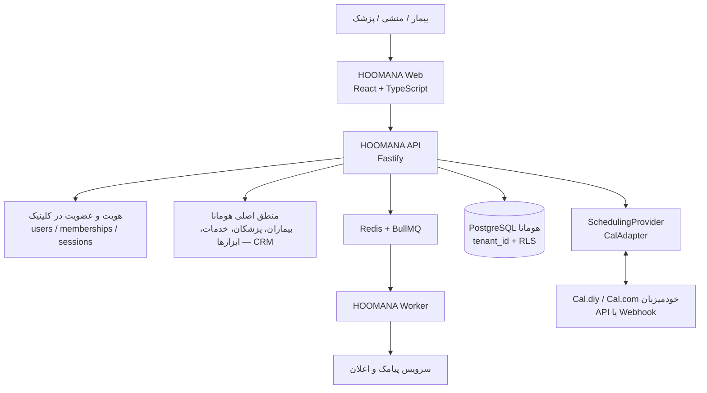

# سند معماری — هومانا (Hoomana) — پلتفرم SaaS نوبت‌دهی و مدیریت کلینیک

- **وضعیت:** سند مرجع محصول (زنده)
- **نسخه:** 2.6 — ۲۱ مهر ۱۴۰۵ (۱۳ اکتبر ۲۰۲۶)
- **هدف:** ساخت یک پلتفرم SaaS کامل و فروش‌شدنی برای پزشکان و کلینیک‌ها. افزونهٔ وردپرسی «پنل هومانا» **فقط مرجع نیازمندی است و دوباره ساخته نمی‌شود**؛ فرانت‌اند/UI-UX، بک‌اند و دیتابیس از صفر و متفاوت ساخته می‌شوند.
- **مخاطب هدف:** پزشکان (و کلینیک‌ها)، با کاربران بیمار / منشی / پزشک.
- **اولویت‌های قطعی:** امنیت، سرعت برنامه، کاربرپسند بودن (UX).
- **منابع:** دیاگرام معماری هدف (پیوست مالک)، `legacy/hmn-crm/` و `legacy/hmn-crm/docs/سند-معماری-پلاگین.md` (فقط برای استخراج نیازمندی)، ADRها در `infra/docs/adr/`.
- **قاعده:** هر تصمیم معماری در یک ADR ثبت می‌شود؛ تصمیم‌های ثبت‌شده باطل نمی‌شوند و فقط با ADR جدید یا به‌روزرسانی مستندِ ADR عوض می‌شوند.

## ۱) مدل محصول و کسب‌وکار

| موضوع             | تصمیم                                                                                                                                 |
| ----------------- | ------------------------------------------------------------------------------------------------------------------------------------- |
| مدل فروش          | اشتراک (SaaS): ثبت‌نام خودخدمت → **پکیج رایگان تستی** → خرید **پکیج ماژولار**                                                         |
| ماژولاریتی        | قابلیت‌ها ماژول‌اند؛ هر پکیج ترکیبی از ماژول‌ها + سهمیه‌ها (کاربر، پیامک، پزشک، شعبه)                                                 |
| سطح‌بندی          | پکیج‌ها «کم و زیاد» دارند (مثلاً پایه/حرفه‌ای/سازمانی)؛ نگاشت پلن→قابلیت باید داده‌محور باشد (plan features/entitlements)، نه کد شرطی |
| پنل مدیریت پلتفرم | مدیریت کاربران و مستاجرها، پلن‌ها، وضعیت اشتراک، تعلیق/فعال‌سازی، شارژ پیامک، مانیتورینگ — جدا و امن‌تر از پنل مستاجر                 |
| تحویل سرویس       | کاربر روی **ساب‌دامین ما** یا **دامنهٔ اختصاصی خودش روی سرور ما** سرویس می‌گیرد                                                       |
| زیرساخت           | تمام سرویس روی سرورهای ما (دیگر هاست مشتری و وردپرس وجود ندارد)                                                                       |

## ۲) معماری هدف

| جزء                      | مسئولیت                                                                                                                                       |
| ------------------------ | --------------------------------------------------------------------------------------------------------------------------------------------- |
| `apps/web` — HOOMANA Web | اپ React+TypeScript؛ پنل مستاجر، پنل پلتفرم، صفحهٔ رزرو عمومی؛ فارسی/RTL؛ موبایل‌اول                                                          |
| `apps/api` — HOOMANA API | Fastify؛ احراز هویت، مستاجر، CRM (بیمار/پزشک/خدمت/نوبت)، زمان‌بندی، پیامک، حسابداری، تنظیمات                                                  |
| `packages/domain`        | منطق کسب‌وکار و ماژول‌های دامنه (مستقل از فریم‌ورک و DB)                                                                                      |
| `packages/db`            | Prisma + مهاجرت‌های SQL؛ **هر جدول کسب‌وکار `tenant_id` دارد + RLS fail-closed** (ADR-0003)                                                   |
| `packages/integrations`  | ادپترهای بیرونی: **SchedulingProvider/CalAdapter**، پیامک (ملی‌پیامک/پنا/…) — **بدون سرویس ایمیل**                                            |
| `apps/worker`            | Redis + BullMQ: ارسال پیامک، وضعیت تحویل، لیست روزانهٔ پزشک، یادآوری‌ها، همگام‌سازی موتور، کارهای زمان‌بند                                    |
| موتور نوبت‌دهی           | **Cal.diy / Cal.com خودمیزبان** (نسخهٔ اختیاری)، از طریق API یا Webhook؛ پشت رابط `SchedulingProvider` تا تعویض موتور بدون بازنویسی ممکن باشد |

- «منطق اصلی هومانا» منبع حقیقت بیماران، پزشکان و خدمات است؛ موتور زمان‌بندی مسئول ظرفیت/اسلات‌ها و رزرو.
- دو مرز مهم: (الف) موتور از طریق ادپتر، نه مستقیم از UI؛ (ب) مستاجر از **Hostname** تشخیص داده می‌شود، نه از ورودی کلاینت.

### پشتهٔ فناوری (زبان‌ها)

| لایه                                           | زبان / فناوری                                                  | جای آن در مخزن          | وضعیت                |
| ---------------------------------------------- | -------------------------------------------------------------- | ----------------------- | -------------------- |
| فرانت‌اند (پنل مستاجر، پنل پلتفرم، صفحهٔ رزرو) | **TypeScript + React 19** (Vite 8، Testing Library)            | `apps/web`              | پوستهٔ آماده         |
| بک‌اند API                                     | **TypeScript روی Node.js 24 + Fastify 5**                      | `apps/api`              | فقط health           |
| کارهای پس‌زمینه                                | **TypeScript + BullMQ روی Redis**                              | `apps/worker`           | اتصال آماده          |
| دیتابیس                                        | **PostgreSQL** (چندمستاجری: `tenant_id` + RLS) با **Prisma 7** | `packages/db`           | فاز ۳ + مهاجرت فاز ۴ |
| اعتبارسنجی مشترک                               | **Zod 4**                                                      | `packages/validation`   | آماده                |
| زیرساخت مشترک                                  | TypeScript (pino برای لاگ، ioredis)                            | `packages/shared`       | آماده                |
| کیفیت                                          | TypeScript 5.9 · Vitest 5 · ESLint 10 · Prettier 3             | ریشهٔ مخزن              | فعال                 |
| موتور نوبت‌دهی                                 | Cal.com/Cal.diy خودمیزبان (سرویس جداگانه، از طریق API/Webhook) | `packages/integrations` | فاز ۵                |

- همه‌چیز **TypeScript** است (فرانت‌اند، API، worker، تست‌ها) و تنها دیتابیس **PostgreSQL** — یک زبان و یک دیتابیس در کل پلتفرم.
- افزونهٔ وردپرسی (PHP + MySQL) هیچ‌جای این پشته نیست و **کد یا دادهٔ آن منتقل نمی‌شود**؛ فقط رفتارهایش به‌عنوان نیازمندی خوانده می‌شود.
- در این مخزن «مهاجرت» یعنی فایل SQL نسخه‌دار که جدول‌های خودمان را در PostgreSQL می‌سازد/تغییر می‌دهد (مثل `20261012000000_phase4_identity_and_auth`)، نه انتقال از وردپرس.

### موتور نوبت‌دهی — واقعیت‌های تأییدشده (۲۰۲۶-۱۰-۱۲)

- **Cal.com در ۱۴ آوریل ۲۰۲۶ بسته شد** (اعلام رسمی cal.com: «Cal.diy will continue as an open option for hobbyists»)؛ کدبیس تولیدی آن دیگر عمومی نیست و مسیر تجاری‌اش پلن‌های ابری یا «on-prem سازمانی» با قرارداد است.
- **Cal.diy** (`github.com/calcom/cal.diy`) نسخهٔ کامیونیتی و **۱۰۰٪ MIT** است، بدون کلید لایسنس، **فقط سلف‌هاست** (نسخهٔ مدیریت‌شده ندارد)؛ نیازمندی: Node ≥18 و PostgreSQL ≥13 (پشتهٔ Next.js/tRPC/Prisma — هم‌خانوادهٔ پشتهٔ ما).
- **دارد:** event type، اتصال تقویم‌ها، ویدیوکنفرانس، Webhook و **API** (پوشهٔ `docs/api-reference/v2` در مخزن).
- **ندارد** (کدهای Enterprise حذف شده): **Teams، Organizations**، SAML SSO، SCIM، Workflows، Routing Forms، Insights.
- هشدار خود پروژه: «با مسئولیت خودتان… صریحاً برای استفادهٔ شخصی/غیرتولیدی» و برای زیرساخت تجاری/سازمانی، Cal.com (میزبانی آن‌ها یا دسترسی سازمانی on-prem) را پیشنهاد می‌کند.

**تصمیم (مالک، ۲۰۲۶-۱۰-۱۲): اجرای Cal.diy خودمیزبان روی سرور ما** به‌عنوان موتور (نسخهٔ رایگان)، با سه قید:

1. UI رزرو، دامنه و ساب‌دامین کاملاً مال ماست؛ به موتور فقط از طریق `SchedulingProvider`/`CalAdapter` (API/Webhook) وصل می‌شویم — پس تعویض موتور در آینده بدون بازنویسی محصول ممکن است.
2. چندمستاجری از موتور انتظار نمی‌رود (Cal.diy اصلاً Teams/Organizations ندارد)؛ جداسازی همان لایهٔ خودمان است: `tenant_id` + RLS + نگاشت «مستاجر/پزشک → کاربر و event type در موتور».
3. نسخه pin شود، به‌روزرسانی‌های امنیتی رصد شود، و پیش از فروش عمومی/مقیاس یک «دروازهٔ تجاری» بازبینی شود: لایسنس سازمانی Cal.com یا جانشین.

- **کلود Cal.com (پلن رایگان شخصی / تیمی per-user) برای مدل ما مناسب نیست:** دادهٔ کلینیک‌ها روی زیرساخت سوم‌شخص، هزینهٔ per-user با رشد تعداد پزشکان، و وایت‌لیبل/فروش مجدد سؤال‌دار — در حالی که مدل ما «روی سرور ما / دامنهٔ خودشان» است.

## ۳) مستاجر، دامنه و جداسازی

- هر مستاجر: ساب‌دامین (مثل `clinic.humana.app`) یا دامنهٔ اختصاصی روی سرور ما؛ مدیریت و تأیید دامنه با جدول `domains` (فاز ۳) + گواهی TLS و مسیر تأیید (CNAME/A).
- جداسازی سخت‌گیرانه: `tenant_id` در همهٔ جدول‌ها + RLS با سیاست fail-closed (`NULLIF(current_setting('app.current_tenant_id', true), '')`).
- اختیار پلتفرم ساختاراً جدا از عضویت مستاجر است (`platform_admins`, با MFA)؛ هیچ ترکیبی از عضویت‌ها اختیار پلتفرم نمی‌سازد.

### حالت مستاجر: مطب (تک‌پزشک) در برابر کلینیک

- هر مستاجر یک **حالت** دارد که در تنظیمات پنل انتخاب می‌شود: `SOLO` (مطب/تک‌پزشک) یا `CLINIC` (چندپزشک).
- **`SOLO`:** انتخاب پزشک در جریان نوبت‌دهی نمایش داده نمی‌شود (نوبت‌ها به همان پزشک نسبت داده می‌شوند)؛ فرم‌ها و تقویم ساده‌تر می‌شوند.
- **`CLINIC`:** انتخاب پزشک کاملاً معنا دارد؛ برای هر پزشک **روزها و ساعت‌های حضور** تعریف می‌شود و اسلات‌ها فقط از پزشکانِ حاضر در آن روز ساخته می‌شوند؛ استثناهای زمان‌بندی هدف «کل مرکز / پزشک / خدمت» دارند (همان الگوی افزونه).
- نگاشت به موتور (Cal.diy): `SOLO` = یک کاربر/تقویم؛ `CLINIC` = یک کاربر و event type به‌ازای هر پزشک، با نگاشت «پزشک ↔ کاربر موتور» در پایگاه دادهٔ خودمان.
- تبدیل `SOLO` به `CLINIC` بعداً ممکن است (افزودن پزشک)؛ برعکسش هشدار می‌گیرد.
- پیاده‌سازی: ستون `tenants.mode` در **مهاجرت جدید فاز ۶** (رو‌به‌جلو)؛ به مهاجرت D-C دست نمی‌زنیم.

## ۴) پیامک و اعلان

دو مدل پشتیبانی می‌شود (هر دو پشت یک ادپتر مستقل از تأمین‌کننده) — **ترتیب اجرا (تصمیم مالک ۲۰۲۶-۱۰-۱۳): فاز فعلی فقط پنل مرکزی؛ حساب مستقل هر مشتری بعد از گرفتن نمایندگی ملی‌پیامک:**

1. **پنل مستقل هر مستاجر:** اعتبارنامهٔ خودِ کلینیک (مثلاً ملی‌پیامک یا پنا) در تنظیمات مستاجر؛ ارسال از خط خودش.
2. **پنل مرکزی ما با شارژ اعتباری:** کیف پول مستاجر، شارژ توسط مستاجر یا پلتفرم، کسر به‌ازای هر پیام/بخش، سقف روزانه و هشدار کمبود اعتبار.

اجزای لازم: ادپتر ارسال، صف BullMQ، لاگ کامل (بدون راز)، وضعیت تحویل، الگوهای قابل ویرایش (با جای‌نگهدار)، بخش‌بندی هوشمند متن (۷۰ کاراکتر هر بخش)، ضدتکرار، محافظت از سوءمصرف.
انواع پیام: `booking`, `edit`, `cancel`, `reminder`, `otp`, `welcome`, `daily-list` (لیست روزانهٔ پزشک)، `staff-invite` + پیام‌های پلتفرم (پایان تریال، تعلیق، کمبود اعتبار، رسید شارژ). کاتالوگ کامل الگوها (کلید، متغیرها به ترتیب، متن نمونه، قیدها): `infra/docs/integrations/sms-templates.md`.

- تأمین‌کنندهٔ اول (ملی‌پیامک کنسول): مدل کامل API، نقشهٔ قابلیت‌ها و قواعد ادپتر در `infra/docs/integrations/melipayamak.md` ثبت شده است.
- ارسال **لحظه‌ای و بدون تأیید** و صرفاً **الگومحور** (فقط متغیرها تغییر می‌کنند)؛ لیست بلند و OTP استثناهای فنی‌اند (مسیر bulk و سرویس OTP).

## ۵) قابلیت‌های محصول (دامنهٔ کار)

- **بیماران:** پرونده (شناسه، **شماره تلفن همراه**، شمارهٔ پرونده، کد ملی)، جست‌وجو، تاریخچهٔ نوبت، **ایمپورت گروهی از اکسل** (نیازمندی تازه — ۵-الف).
- **پنل بیمار:** هر بیمار با ورود OTP می‌تواند نوبت‌های خودش و اطلاعات خودش را ببیند (یکی از دو هدف اصلی پنل، کنار مدیریت مطب/کلینیک).
- **پزشکان و خدمات:** CRUD، پیوند چندبه‌چند خدمت ↔ پزشک (بخش ۵-ج)، مبلغ خدمت **اختیاری**، زمان‌های کاری، (اختیاری) شمارهٔ پزشک برای لیست روزانه.
- **نوبت‌ها:** ثبت منشی، رزرو آنلاین (با OTP)، جابجایی/کنسل نوبت‌های نرسیده **توسط اپراتور** (بخش ۵-ه)، نشانهٔ مالی پرداخت‌شده/پرداخت‌نشده، تقویم شمسی روز/هفته/ماه — «وضعیت نوبت» وجود ندارد.
- **زمان‌بندی:** ساعت کاری، گام اسلات، بافر، حداقل فاصله، سقف روزانه، رزرو هم‌زمان، استثناها (تعطیل/مرخصی/مسدود/ساعت ویژه) با هدف «کل مرکز / پزشک / خدمت».
- **پیامک:** بخش ۴ + پیش‌نمایش زنده و تست ارسال، **ارسال لیست بیماران هر پزشک** (زمان‌بندی‌شده + لحظه‌ای — ۵-ب)، یادآوری نوبت.
- **حسابداری:** دفتر تراکنش‌ها — **درآمد/هزینه**، اتصال اختیاری به بیمار و نوبت/خدمت، **توضیحات**، دسته‌ها، روش‌های پرداخت، گزارش روز/ماه (تفصیل و نقاط ورود: بخش ۵-د؛ پیاده‌سازی فاز بعد، ولی در ساختار ماژول‌ها دیده شود).
- **حالت مطب / کلینیک:** هر مستاجر `SOLO` (تک‌پزشک/مطب) یا `CLINIC` (چندپزشک) است؛ در `SOLO` انتخاب پزشک در نوبت‌دهی معنا ندارد و نمایش داده نمی‌شود.
- **پورتال بیمار (هدف دوم پنل):** بیمار با OTP موبایل وارد می‌شود و نوبت‌ها/اطلاعات خودش را می‌بیند؛ رزرو عمومی بدون حساب هم باقی می‌ماند.
- **پنل پلتفرم:** مدیریت کاربران/مستاجرها، پلن‌ها و اشتراک‌ها، شارژ پیامک، وضعیت سیستم.
- مرجع کامل رفتارهای موجود برای تطبیق/تکمیل: `legacy/hmn-crm/docs/سند-معماری-پلاگین.md` (بخش‌های ۴، ۵، ۱۰، ۱۱).

### ۵-الف) ایمپورت بیماران از اکسل (نیازمندی تازهٔ مالک — ۲۰۲۶-۱۰-۱۲)

- دکمهٔ «ایمپورت از اکسل» در لیست بیماران، برای نقش‌های مجاز (`OWNER`، `RECEPTION`).
- ستون‌های پذیرفته‌شدهٔ فایل: **نام، نام خانوادگی، شماره تلفن همراه (اجباری)، شمارهٔ ملی، شمارهٔ پرونده، تاریخ تولد**.
- رفتار: پیش‌نمایش قبل از ثبت → اعتبارسنجی ردیفی (شمارهٔ ملی ۱۰ رقمی با رقم کنترلی، تاریخ معتبر، ستون‌های اجباری) → ثبت ردیف‌های سالم + **گزارش خطای قابل دانلود** برای ردیف‌های ناموفق.
- تکراری‌ها: تشخیص اول بر اساس **شماره تلفن همراه** (کلید اصلی بیمار برای پیامک و جست‌وجو)، سپس شمارهٔ ملی و در نبود آن شمارهٔ پرونده؛ سیاست «به‌روزرسانی یا رد» قابل انتخاب.
- پردازش فایل‌های بزرگ در `apps/worker`؛ سقف پیشنهادی ۵٬۰۰۰ ردیف در هر فایل؛ فایل موقت پس از پردازش پاک شود؛ محتوای فایل هرگز در لاگ نوشته نشود.
- **نکته‌های باز (هنگام پیاده‌سازی):** فرمت ستون تاریخ در فایل (شمسی/میلادی) و رفتار پیش‌فرض با تکراری‌ها.
- **گام بعدی این ماژول (آینده):** «پروندهٔ بیمار» با گزارش‌های آن، روی همین ساختار بیماران سوار می‌شود (خارج از دامنهٔ فعلی).

### ۵-ب) ارسال لیست بیماران هر پزشک (نیازمندی تازهٔ مالک — ۲۰۲۶-۱۰-۱۲)

- هر پزشک فهرست بیماران **خودش** را با پیامک می‌گیرد (فقط نوبت‌های خودش، نه کل کلینیک).
- دو حالت ارسال: (۱) **زمان‌بندی‌شده** — ساعت ارسال در تنظیمات مستاجر تعیین می‌شود و `apps/worker` با صف/cron اجرا می‌کند؛ (۲) **لحظه‌ای** — دکمهٔ «همین حالا ارسال کن» با یک کلیک برای همان پزشک.
- طراحی جزئیات از قبل تأیید شده و همان مبنا است (بخش ۱۱ سند افزونه): بخش‌بندی هوشمند متن با «(ادامه n/m)»، ضدتکرار روزانه با امکان ارسال دیرهنگام تا پایان روز هدف، پیش‌نمایش زنده، شماره‌های اضافه برای منشی/مدیر، لاگ با نوع پیام `daily-list`.
- وابستگی‌ها: ادپتر پیامک (بخش ۴)، `apps/worker` (BullMQ)، و شمارهٔ معتبر پزشک؛ اگر شماره نبود ارسال نمی‌شود و در تنظیمات هشدار نشان داده می‌شود.
- تصمیم باز: قالب متن پیامک و سقف بخش‌ها در هر پیام (پیش‌فرض: بسته‌بندی خودکار تا ۲ بخش / ≈۱۴۰ کاراکتر).

### ۵-ج) خدمات، پزشکان و پیوند چندبه‌چند (نیازمندی مالک — ۲۰۲۶-۱۰-۱۳)

- هر مستاجر **خدمات خودش** را تعریف می‌کند و **پزشکان خودش** را؛ این دو فهرست مستقل و مستاجر‌محورند (CRUD کامل در دامنهٔ `doctors-services`).
- پیوند پزشک ↔ خدمت **چندبه‌چند** است: یک پزشک چند خدمت انجام می‌دهد و یک خدمت را چند پزشک؛ نگاشت در جدول واسط (`doctor_services`، با `tenant_id` و RLS مثل بقیهٔ جدول‌های مستاجر).
- «پزشکان ارائه‌دهنده» در فرم/ردیف هر خدمت و «خدمات این پزشک» در کارت پزشک، دو نمای همین نگاشت‌اند (طرح `doctors-services.html`).
- **مبلغ خدمت اختیاری است:** خدمت می‌تواند بدون تعرفه ثبت شود؛ پیامدها:
  - در فرم ثبت نوبت، اگر خدمت تعرفه دارد مبلغ پیشنهادی از همان می‌آید (قابل تغییر)؛ اگر ندارد، مبلغ خالی می‌ماند و مالی از تراکنش دستی ثبت می‌شود.
  - در حسابداری، تحلیل «نوبت × تعرفه» فقط برای خدمات دارای تعرفه معنا دارد؛ منبع اعداد اصلی، دفتر تراکنش‌ها است (۵-د).
- اثر در نوبت‌دهی: انتخاب خدمت، فهرست پزشکان را به **ارائه‌دهندگان همان خدمت** محدود می‌کند (و برعکس) تا نوبت به پزشکِ ناتوان از آن خدمت داده نشود؛ در `SOLO` انتخاب پزشک همان قاعدهٔ حذف را دارد.
- حذف/غیرفعال‌کردن خدمت یا پیوند، نوبت‌ها و تراکنش‌های گذشته را دست‌نخورده می‌گذارد؛ فقط انتخاب‌های آینده محدود می‌شود.

### ۵-د) تراکنش‌های مالی — دفتر درآمد/هزینه (نیازمندی مالک — ۲۰۲۶-۱۰-۱۳)

- «دفتر پرداخت‌ها» به **دفتر تراکنش‌ها** گسترش می‌یابد: هر تراکنش **درآمد** یا **هزینه** است.
- فیلدهای تراکنش: نوع (درآمد/هزینه)، مبلغ (تومان)، تاریخ (پیش‌فرض امروز؛ قابل اصلاح برای ثبت تأخیری)، **بیمار** (اختیاری — درآمد معمولاً متصل به بیمار؛ هزینه می‌تواند بدون بیمار باشد، مثل خرید ملزومات)، نوبت/خدمت مرتبط (اختیاری)، روش پرداخت، **توضیحات** (متن آزاد)، ثبت‌کننده و زمان ثبت.
- نمونهٔ مالک: «هومن ۲ میلیون تومان پرداخت کرد — امروز» = یک تراکنش درآمد، متصل به بیمار، با تاریخ امروز و توضیحات.
- **نقاط ورود:** داشبورد (دسترسی سریع)، ردیف هر نوبت در صفحهٔ نوبت‌ها (گزینهٔ «تراکنش»)، و صفحهٔ حسابداری (فرم کامل + دفتر). «ثبت پرداخت» فعلی همان میانبر این فرم است با پیش‌پر‌کردن بیمار/خدمت/نوبت و مبلغ (اگر تعرفه دارد).
- نشانهٔ مالی نوبت (پرداخت‌شده/پرداخت‌نشده) و فهرست/فیلتر «پرداخت‌نشده‌های امروز» از همین تراکنش‌ها ساخته می‌شوند.
- گزارش‌ها: جمع درآمد/هزینهٔ بازه از دفتر تراکنش‌ها؛ تحلیل «نوبت × تعرفه» به‌عنوان **برآورد** و جداگانه (نیازمند تأیید — بخش ۱۰).
- قواعد: هر تراکنش مالک و ثبت‌کننده دارد؛ ویرایش/ابطال با اختیار صریح و ثبت در `audit_logs`؛ حذف سخت نداریم. دسترسی پیش‌فرض: `OWNER` و `RECEPTION`؛ پزشک پیش‌فرض بدون دسترسی مالی؛ `CUSTOM` فقط با grant ماژول `accounting`.

### ۵-ه) جابجایی و کنسل نوبت توسط اپراتور (نیازمندی مالک — ۲۰۲۶-۱۰-۱۳)

- فقط روی نوبتی که **زمانش نرسیده** (نوبت‌های آینده؛ و امروز تا پیش از ساعت نوبت) دو اقدام «جابجایی» و «کنسل» هست؛ این دو را **اپراتور** (منشی/مدیر) انجام می‌دهد، نه بیمار.
- نوبت‌های گذشته این دو اقدام را ندارند؛ فقط پرونده/تاریخچه و اثر مالی می‌ماند.
- «کنسل» حذف نمی‌کند: نوبت از نماهای فعال (تقویم/امروز/فهرست آینده) کنار می‌رود ولی در تاریخچهٔ بیمار، لاگ پیامک و سابقهٔ مالی می‌ماند؛ پیامک «لغو نوبت» طبق الگوی تأییدشده.
- «جابجایی» همان نوبت را به روز/ساعت آزاد جدید (همان پزشک و خدمت) منتقل می‌کند؛ اعتبارسنجی اسلات و هشدار تداخل مثل «ثبت نوبت جدید» است (هشدار اطلاع‌دهنده، نه ممنوعیت). پیامک اطلاع‌رسانی طبق نوع `edit`.
- سیاست مهلت (الگوی پیامک فعلی: «تا ۲ ساعت قبل تماس بگیرید») اگر قطعی شود، در تنظیمات زمان‌بندی مستاجر می‌نشیند.
- ثبت فنی کنسل بدون «وضعیت نوبت» و امکان لغو/جابجایی از سمت بیمار در پورتال (فاز ۷): تصمیم باز (بخش ۱۰).

## ۶) هویت، نقش‌ها و مجوزها (ADR-0004)

| نقش                              | دسترسی                                                                 |
| -------------------------------- | ---------------------------------------------------------------------- |
| بیمار (با حساب)                  | ورود با OTP موبایل؛ فقط نوبت‌های خودش و اطلاعات خودش                   |
| بیمار (بدون حساب)                | رزرو عمومی با OTP از سایت، بدون ورود به پنل                            |
| `RECEPTION` (منشی — نقش پیش‌فرض) | نوبت‌ها، بیماران، ثبت رزرو                                             |
| `DOCTOR` (پزشک)                  | نوبت‌های خودش، لیست روزانه، بیماران مرتبط                              |
| `OWNER` (مالک کلینیک)            | همهٔ امتیازهای مستاجر + کاربران، تنظیمات، (اختیاری) حسابداری           |
| `CUSTOM` (کاربر ساختهٔ مدیر)     | فقط ماژول‌هایی که مدیر برای او انتخاب کرده (نقش پیش‌فرض + grant ماژول) |
| `platform_admin`                 | پنل پلتفرم: مدیریت مستاجرها، پلن‌ها، شارژ، تعلیق — با MFA              |

- ورود کارکنان: **شمارهٔ موبایل + رمز** (scrypt)؛ **بدون سرویس ایمیل** — تأیید، بازیابی رمز و OTP همه از پیامک؛ `email` فقط فیلد اختیاری پروفایل است. نشست سرور-محور با کوکی HttpOnly، CSRF لایه‌ای، محدودیت نرخ.
- «کدام ردیف» را RLS تعیین می‌کند؛ «کدام اقدام» را لایهٔ اپ — هر مسیر باید بررسی مجوز صریح داشته باشد.
- مدل مجوزها: **نقش پیش‌فرض + انتخاب ماژول** — مدیر می‌تواند کاربر بسازد و برای هر کاربر ماژول‌ها را انتخاب کند («کاستوم»)؛ پزشک هم علاوه بر بیمارانِ خودش، هر ماژولی که مدیر بدهد را می‌بیند.

### ۶-الف) حالت پنل: مطب یا کلینیک (نیازمندی مالک — ۲۰۲۶-۱۰-۱۲)

- هر مستاجر یکی از دو حالت را دارد: **`SOLO` (مطب/تک‌پزشک)** یا **`CLINIC` (کلینیک چندپزشک)**.
- در `SOLO` انتخاب پزشک در نوبت‌دهی **معنا ندارد** و در UI نمایش داده نمی‌شود؛ پزشک ضمنی = مالک مطب.
- در `CLINIC` برنامهٔ حضور پزشکان در روزها اهمیت دارد و **انتخاب پزشک** در نوبت‌دهی، فیلترها و گزارش‌ها کاملاً معنا پیدا می‌کند.
- اثر فنی: پرچم `type` روی `tenants` (`SOLO | CLINIC`)؛ منطق نوبت‌دهی و UI فقط از همین پرچم تبعیت می‌کند و از «تعداد پزشکان» استنتاج نمی‌شود.

### ۶-ب) دو هدف پنل (نیازمندی مالک — ۲۰۲۶-۱۰-۱۲)

1. **مدیریت مطب/کلینیک:** نوبت‌ها و رزروها، بیماران، پزشکان، حسابداری مالی.
2. **رزرو نوبت توسط بیمار:** مسیر عمومی (با حساب / بدون حساب) با تأیید OTP موبایل.

### ۶-ج) مدل فنی مجوزهای ماژولی (پیشنهاد — نیازمند ADR مکمل پیش از ساخت)

- نقش‌های سیستمی همان enum تأییدشدهٔ A-7 می‌مانند (`OWNER | DOCTOR | RECEPTION`).
- «کاستوم» از یک لایهٔ تازه می‌آید: **نقش سفارشی هر مستاجر + نگاشت ماژول‌ها** (`tenant_roles` و `tenant_memberships.roleId`، یا `grants` روی عضویت)؛ فهرست ماژول‌ها **کد-محور و ثابت** است و نقش سفارشی فقط می‌تواند ماژول‌های همان مستاجر را بدهد — **هرگز اختیار پلتفرم**.
- بیمار در `tenant_memberships` وارد نمی‌شود (عضو کارکنان نیست)؛ دسترسی‌اش به داده با **شمارهٔ تأییدشدهٔ خودش** گره می‌خورد (حالت `SOLO` هم همین قاعده را دارد).
- پیش از پیاده‌سازی این بخش، یک **ADR مکمل** (نقش‌ها، ماژول‌ها، حالت مطب/کلینیک) نوشته می‌شود.
- بیماران عضو `tenant_memberships` نمی‌شوند؛ دسترسی بیمار از طریق **اتصال حساب به پروندهٔ بیمار** است و هرگز از رکوردهای خودش فراتر نمی‌رود.
- مقدار `CUSTOM` **افزایشی** (`ALTER TYPE ... ADD VALUE`) هنگام ساخت ماژول مجوزها اضافه می‌شود؛ حذف مقدار انوم گران است و افزودنش ارزان.

## ۷) الزامات غیرکارکردی (امنیت، سرعت، UX)

- **امنیت:** RLS + نقش‌های کم‌ترین امتیاز DB (`hmn_migrator` فقط CLI، `hmn_app` اجرا، `hmn_platform` فقط خواندن)؛ رازها فقط در env؛ هیچ کلید/بدنهٔ درخواست در لاگ؛ اعتبارسنجی ورودی در لبه؛ محدودیت نرخ و ضدسوءمصرف؛ بک‌آپ و بازگردانی آزموده.
- **سرعت:** صف برای کارهای کند (پیامک، همگام‌سازی موتور)، کش Redis برای خواندن‌های موتور، ایندکس‌گذاری و بازبینی کوئری، پرهیز از فراخوانی هم‌زمان و کند موتور در مسیر کاربر؛ هدف پیشنهادی: p95 مسیرهای پرکاربرد زیر ۳۰۰ms (نیازمند تأیید مالک).
- **UX:** فارسی و راست‌به‌چپ، تقویم و اعداد شمسی، موبایل‌اول، onboarding کوتاه (ثبت‌نام → پکیج رایگان → اولین نوبت در چند دقیقه)، پیام‌های خطای روشن، سرعت بارگذاری پنل.
- **کانال ارتباطی:** فقط پیامک — این محصول **هیچ سرویس ایمیلی ندارد**؛ هیچ جریانی (تأیید، بازیابی رمز، اعلان، دعوت کاربر) نباید به ایمیل وابسته باشد.

## ۸) ماژول‌ها و آماده‌سازی فروش پکیجی

- ماژول‌های دامنه: `identity`, `tenants`, `patients`, `doctors-services`, `appointments`, `scheduling`, `messaging`, `accounting`, `billing/entitlements`, `platform-admin`.
- نگاشت «پکیج → ماژول‌ها + سهمیه‌ها» داده‌محور ذخیره می‌شود (`subscription_plans` + جدول‌های entitlement/feature) تا عرضهٔ پلن جدید تغییر کد نخواهد.
- شرایط پکیج رایگان (مدت/سقف) و قیمت‌گذاری = تصمیم مالک (بخش ۱۰).

## ۹) نقشهٔ راه

| فاز | محتوا                                                                                                                                                                   | وضعیت                           |
| --- | ----------------------------------------------------------------------------------------------------------------------------------------------------------------------- | ------------------------------- |
| ۳   | بنیاد: اسکیما، RLS، نقش‌های DB، نگهبان‌های تست                                                                                                                          | ✅ تمام                         |
| ۴   | هویت و احراز هویت (ADR-0004): مهاجرت D-C → مسیرهای ورود/ثبت‌نام → UI ورود                                                                                               | **جاری — گام بعدی: مهاجرت D-C** |
| ۵   | ثبت‌نام خودخدمت + ساخت مستاجر + پکیج رایگان؛ MVP پنل پلتفرم؛ ادپتر `SchedulingProvider` + Cal.diy (با ADR مکمل)؛ پایهٔ entitlements                                     | بعد از ۴                        |
| ۶   | CRM: بیماران (**ایمپورت اکسل**)/پزشکان/خدمات/نوبت‌ها/زمان‌بندی؛ worker و پیامک؛ ساب‌دامین/دامنهٔ اختصاصی؛ پنل مستاجر + **نقش‌های سفارشی/مجوز ماژولی و حالت مطب/کلینیک** | بعد از ۵                        |
| ۷   | رزرو آنلاین عمومی + OTP، **ارسال لیست بیماران پزشک** (زمان‌بندی‌شده + لحظه‌ای)، یادآوری، حسابداری و گزارش‌ها، شارژ پیامک مرکزی، پلن‌های پولی و صورتحساب                 | بعد از ۶                        |

## ۱۰) تصمیم‌های باز (نیاز به تأیید مالک)

1. **موتور نوبت‌دهی:** ✅ قطعی شد — **Cal.diy خودمیزبان** (نسخهٔ رایگان، MIT) با قیدهای بخش ۲. باقی‌مانده: محل استقرار در زیرساخت و انتخاب مسیر اصلی (API یا Webhook).
2. سیاست پکیج رایگان: مدت آزمایش و سقف‌ها (تعداد کاربر/نوبت/پیامک).
3. قیمت‌گذاری پلن‌ها و تعریف دقیق «کم/زیاد» هر پکیج.
4. مدل شارژ پیامک مرکزی (نرخ هر بخش، حداقل شارژ) و اینکه پنل مستقل به‌طور پیش‌فرض باشد یا گزینهٔ افزودنی.
5. درگاه پرداخت و صورتحساب (فاز ۷) — داخلی/خارجی؟
6. میزبانی و زیرساخت (کجا؟) و سیاست بک‌آپ/بازیابی و SLA.
7. **مبنای اعداد درآمد و خدمات بدون تعرفه:** «درآمد امروز/این ماه» از دفتر تراکنش‌ها (پول واقعی) باشد یا از «نوبت × تعرفه» (برآورد)؟ پیشنهاد: اعداد اصلی از دفتر تراکنش‌ها و تحلیل تعرفه‌ای جدا و با برچسب «برآورد». همچنین آیا «دفتر تراکنش + ثبت از داشبورد/نوبت‌ها» همراه فاز ۶ (CRM) بیاید و گزارش‌های کامل حسابداری در فاز ۷ بماند؟ پیشنهاد: بله.
8. **کنسل و پورتال بیمار:** ثبت فنی کنسل بدون «وضعیت نوبت» — پیشنهاد: مهر زمانی لغو (`cancelled_at`) و خروج از نماهای فعال با حفظ تاریخچه؛ و آیا لغو/جابجایی از سمت بیمار در پورتال بیمار (فاز ۷) اضافه شود یا فقط اپراتور؟ (بخش ۵-ه.)

## ۱۱) بدهی‌های افزونه که نباید تکرار شوند

بررسی‌نشدن مجوز در یک صفحهٔ مالی؛ دو مسیر جدا برای ذخیرهٔ تنظیمات پیامک؛ آمیختگی منطقهٔ زمانی (در SaaS: همیشه `Asia/Tehran`)؛ نبود مدیریت طول پیامک؛ کش کوتاه و کندی درخواست‌های نوشتن موتور؛ اتکا به کرون غیرقابل‌اعتماد؛ fallback به جدول‌های بیرونی.

## ۱۲) به‌روزرسانی این سند

هر تغییر معماری: به‌روزرسانی سند + ارجاع ADR + ثبت تاریخچه.

| نسخه | تاریخ       | تغییر                                                                                                                                                                                                                                                                                                     |
| ---- | ----------- | --------------------------------------------------------------------------------------------------------------------------------------------------------------------------------------------------------------------------------------------------------------------------------------------------------- |
| 1.0  | ۲۰ مهر ۱۴۰۵ | استخراج نیازمندی از افزونه + معماری هدف اولیه                                                                                                                                                                                                                                                             |
| 2.0  | ۲۰ مهر ۱۴۰۵ | بازنویسی بر پایهٔ مدل نهایی محصول: پلتفرم SaaS فروش‌شدنی برای پزشکان، پکیج‌های ماژولار، پنل پلتفرم، ساب‌دامین/دامنهٔ اختصاصی، دو مدل پنل پیامکی، معماری طبق دیاگرام مالک                                                                                                                                  |
| 2.1  | ۲۰ مهر ۱۴۰۵ | افزودن جدول پشتهٔ فناوری؛ تحقیق و تصمیم قطعی موتور نوبت‌دهی (Cal.diy خودمیزبان، MIT)                                                                                                                                                                                                                      |
| 2.2  | ۲۰ مهر ۱۴۰۵ | دو نیازمندی تازهٔ مالک: ایمپورت بیماران از اکسل (۵-الف) و ارسال لیست بیماران هر پزشک با پیامک — زمان‌بندی‌شده + لحظه‌ای (۵-ب)                                                                                                                                                                             |
| 2.3  | ۲۰ مهر ۱۴۰۵ | افزودن شماره تلفن همراه به فیلدهای بیمار و ایمپورت؛ حذف کانال ایمیل و انتقال شناسهٔ ورود به موبایل (اصلاحیهٔ ADR-0004 A-2)                                                                                                                                                                                |
| 2.4  | ۲۰ مهر ۱۴۰۵ | دو حالت مستاجر (مطب تک‌پزشک / کلینیک چندپزشک)؛ مدل دسترسی چهار‌گانه (مدیر/پزشک/بیمار/کاستوم با grant ماژول)؛ پنل بیمار (اصلاحیهٔ ADR-0004 A-7)                                                                                                                                                            |
| 2.5  | ۲۱ مهر ۱۴۰۵ | نیازمندی‌های تازهٔ مالک: پیوند چندبه‌چند خدمات ↔ پزشکان و مبلغ اختیاری خدمت (۵-ج)؛ دفتر تراکنش‌ها — درآمد/هزینه، اتصال اختیاری به بیمار، توضیحات و نقاط ورود در داشبورد/نوبت‌ها/حسابداری (۵-د)؛ جابجایی/کنسل نوبت‌های نرسیده توسط اپراتور (۵-ه)؛ اصلاح فهرست نوبت‌ها (حذف «وضعیت‌ها»، افزودن نشانهٔ مالی) |
| 2.6  | ۲۱ مهر ۱۴۰۵ | کاتالوگ الگوهای پیامک (۱۳ الگو با متغیرهای ترتیبی)؛ قید «لحظه‌ای، بدون تأیید، الگومحور»؛ ترتیب اجرا: فعلاً پنل مرکزی، حساب مستقل هر مشتری فاز بعد                                                                                                                                                         |
